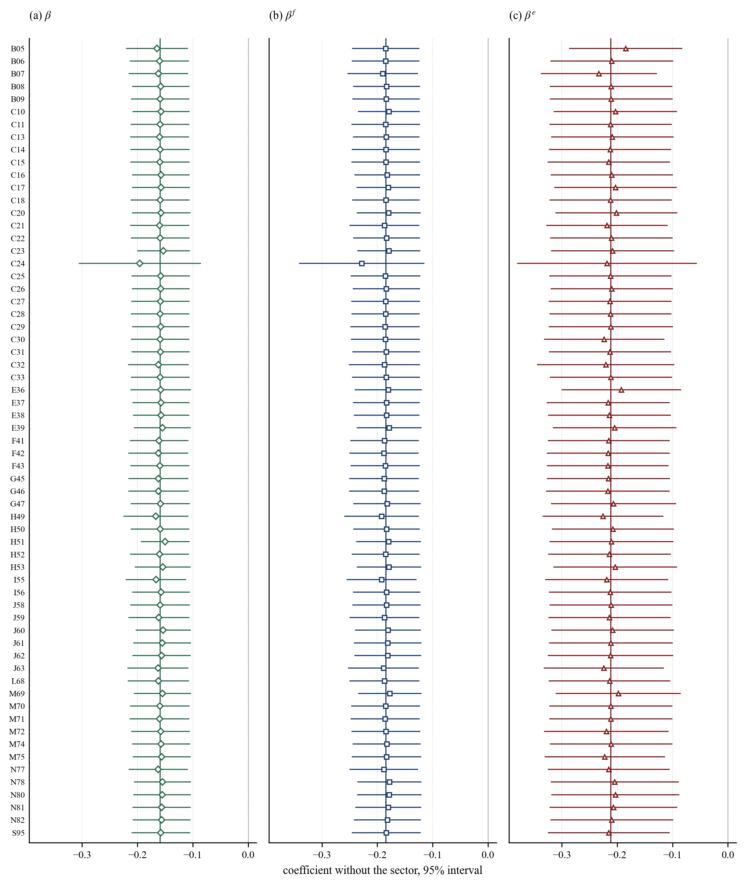

# Online Appendix to “The Exchange Rate and the Labor Share: A Material Cost Channel”

The full text of the Online Appendix follows, with all its tables, equations, figures and notes; the typeset version is [Online_Appendix.pdf](Online_Appendix.pdf).

**Contents**

- [OA.1 Data](#oa1-data)
- [OA.2 The world price instrument](#oa2-the-world-price-instrument)
  - [Table OA1. Products, world prices and Rotemberg weights of the instrument](#table-oa1)
- [OA.3 Further robustness checks](#oa3-further-robustness-checks)
  - [Table OA2. Real interest rate control and long difference](#table-oa2)
  - [Figure OA1. Estimates without one sector at a time](#figure-oa1)
- [OA.4 Supplier prices](#oa4-supplier-prices)
  - [Table OA3. Cumulative supplier price responses, with and without electricity and gas](#table-oa3)
- [OA.5 The lagged coefficient of Table 5](#oa5-the-lagged-coefficient-of-table-5)
  - [Table OA4. The coefficients of Table 5, column (3), by component](#table-oa4)
- [OA.6 Local projections](#oa6-local-projections)
  - [Table OA5. Local projections of the labor share](#table-oa5)
- [OA.7 Contributions to the labor share](#oa7-contributions-to-the-labor-share)
- [OA.8 The elasticity of substitution](#oa8-the-elasticity-of-substitution)
  - [Table OA6. The elasticity of substitution between materials and primary inputs](#table-oa6)
- [References](#references)

---

Equations, tables and figures without “OA” refer to the paper.

## OA.1 Data

A confidential cell is recovered from its section total when it is the only one in its section and year; ten of the 63 sectors still miss some years, which leaves 719 observations. Value added adds the change in stocks of purchased goods to the published figure, $VA=VA^{pub}+\Delta S$. When inflation is high, part of $\Delta S$ is a holding gain, so our value added is an upper bound and the published one a lower bound. The services PPI starts in 2017 and is chained back with the section’s value added deflator. Only employment activities (N78) have a markup below one (0.992). The markup leaves out the cost of capital, so it is an upper bound on the margin over full cost.

## OA.2 The world price instrument

The instrument of eq. (23) prices the 27 goods of Table OA1. The mining product of the 2012 input–output table is split into coal, crude petroleum, natural gas, metal ores and other mining, with a RAS procedure that keeps structural zeros. Six-digit HS codes are assigned to products through the official correspondences from HS to CPC 2.1 and from CPC 2.1 to CPA 2.1. The world price of a good chains the annual log change of its unit values, the mean over its codes weighted by 2013 imports, after changes more than $\ln2$ from the weighted median are dropped; gold is left out of basic metals. Goods without a world price, such as services, get no weight, so the weights of a sector sum to 0.389 on average.

The identification comes from several groups of goods, not from energy alone. The effective number of products is 15 (Borusyak et al., 2022). The Rotemberg weights (Goldsmith-Pinkham et al., 2020) put 43% on waste and scrap and basic metals and 37% on the energy products, and almost all of the weight falls on products whose own estimate is negative. Dropping any one product, all energy products or the two largest leaves the estimate between −0.171 and −0.151 (Table OA1).

**Table OA1. Products, world prices and Rotemberg weights of the instrument**

| Product                            | Price | Weight, % | Log change, 2020–2022 | Rotemberg weight | $\hat{\beta}$ without the product | $F$ |
|:-----------------------------------|:------|-------------:|-------------------------:|--------------------:|---------------------------------------:|------:|
| A01 Crops and livestock            | UV    | 1.88         | 0.41                     | 0.017               | −0.157                                 | 351   |
| A02 Forestry                       | UV    | 0.35         | 0.53                     | 0.006               | −0.159                                 | 345   |
| A03 Fish                           | UV    | 0.04         | 0.31                     | 0.000               | −0.159                                 | 352   |
| B05 Coal                           | UV    | 0.27         | 1.16                     | 0.012               | −0.158                                 | 345   |
| B06 Crude petroleum                | WB    | 0.00         | 0.86                     | 0.000               | −0.159                                 | 352   |
| B06 Natural gas                    | WB    | 0.59         | 2.52                     | 0.126               | −0.158                                 | 226   |
| B07 Metal ores                     | UV    | 0.72         | 0.40                     | 0.063               | −0.159                                 | 240   |
| B08 Other mining                   | UV    | 0.44         | 0.44                     | 0.006               | −0.157                                 | 347   |
| C10–C12 Food, beverages, tobacco   | UV    | 1.86         | 0.31                     | 0.006               | −0.156                                 | 354   |
| C13–C15 Textiles, apparel, leather | UV    | 2.88         | 0.15                     | 0.009               | −0.162                                 | 345   |
| C16 Wood                           | UV    | 1.21         | 0.24                     | 0.006               | −0.158                                 | 397   |
| C17 Paper                          | UV    | 1.80         | 0.41                     | 0.019               | −0.158                                 | 335   |
| C19 Refined petroleum              | UV    | 3.38         | 0.85                     | 0.089               | −0.151                                 | 133   |
| C20 Chemicals                      | UV    | 4.31         | 0.46                     | 0.077               | −0.162                                 | 281   |
| C21 Pharmaceuticals                | UV    | 0.51         | −0.07                    | 0.000               | −0.159                                 | 360   |
| C22 Rubber and plastics            | UV    | 1.68         | 0.14                     | 0.002               | −0.159                                 | 376   |
| C23 Non-metallic minerals          | UV    | 1.55         | 0.16                     | 0.008               | −0.156                                 | 345   |
| C24 Basic metals                   | UV    | 4.17         | 0.47                     | 0.213               | −0.156                                 | 74    |
| C25 Fabricated metals              | UV    | 1.32         | 0.17                     | 0.003               | −0.159                                 | 376   |
| C26 Electronics                    | UV    | 1.17         | 0.28                     | −0.006              | −0.162                                 | 364   |
| C27 Electrical equipment           | UV    | 1.33         | 0.11                     | −0.002              | −0.159                                 | 358   |
| C28 Machinery                      | UV    | 0.93         | 0.01                     | −0.002              | −0.159                                 | 360   |
| C29 Motor vehicles                 | UV    | 0.82         | 0.09                     | −0.002              | −0.158                                 | 386   |
| C30 Other transport equipment      | UV    | 0.42         | −0.01                    | 0.000               | −0.159                                 | 351   |
| C31–C32 Furniture, other goods     | UV    | 0.49         | 0.10                     | −0.006              | −0.158                                 | 410   |
| D35 Electricity and gas            | WB    | 2.50         | 2.32                     | 0.141               | −0.171                                 | 205   |
| E37–E39 Waste and scrap            | UV    | 2.25         | 0.52                     | 0.215               | −0.164                                 | 36    |
| All products (baseline)            |       | 38.85        |                          | 1.000               | −0.159                                 | 352   |
| Energy products                    |       | 6.74         |                          | 0.368               | −0.161                                 | 52    |
| Waste and scrap, basic metals      |       | 6.42         |                          | 0.428               | −0.161                                 | 14    |

Notes: The goods of $Z_{jt}^{f}$, eq. (23). Price: UV, chained index of the US dollar unit values of Türkiye’s imports in UN Comtrade, from 4,840 six-digit HS codes with 2013 imports of 208.1 billion US dollars (80% of all imports); WB, World Bank prices as annual averages, with gas weighted by 0.803 and coal by 0.197 for electricity and gas. Weight: share in the variable cost of the sector’s input–output column, eq. (24), mean over the 63 sectors; crude petroleum enters only C19, outside the sample. Log change: $\ln P_{p,2022}^{f}-\ln P_{p,2020}^{f}$. Rotemberg weight: $\alpha_{p}$ in the 2SLS estimate of eq. (19) (Goldsmith-Pinkham et al., 2020); the weights sum to one, the negative ones to −0.018, and the products whose own just-identified estimate is negative carry 0.993. The Herfindahl index of the product shares of the instrument is 0.065, an effective number of 15.3 products and about 179 product-year shocks (Borusyak et al., 2022). Last two columns: eq. (19) with the product or group dropped from the instrument, and its cluster-robust first-stage $F$. Energy products: coal, crude petroleum, natural gas, refined petroleum, electricity and gas.

## OA.3 Further robustness checks

Table OA2 adds two checks to Table B1: a control for material intensity times the real interest rate, and the long difference over 2017–2022. Both leave the estimate of eq. (19) negative and significant; in the long difference the coefficients of the two channels keep their sign but lose precision. Figure OA1 drops one sector at a time.

**Table OA2. Real interest rate control and long difference**

|                                        | Eq.&nbsp;(19)  $\beta$ | Eq.&nbsp;(19)  $F$ | Eq.&nbsp;(20)  $\beta^{f}$ | Eq.&nbsp;(20)  $\beta^{e}$ | $N/G$ |
|:---------------------------------------|:--------------------------:|:----------------------:|:------------------------------:|:------------------------------:|:-------:|
| (1) Baseline                           | −0.159\*\*\*    | 352                    | −0.184\*\*\*        | −0.212\*\*\*        | 719/63  |
|                                        | (0.027) [0.006]            |                        | (0.031) [0.005]                | (0.056) [0.015]                |         |
| (2) $m_{j}\times$ real interest rate | −0.168\*\*\*    | 84                     | −0.161\*\*\*        | −0.188\*\*\*        | 719/63  |
|                                        | (0.048) [0.026]            |                        | (0.031) [0.006]                | (0.059) [0.044]                |         |
| (3) Long difference, 2017–2022         | −0.121\*\*\*    | 80                     | −0.128                         | −0.343                         | 56/56   |
|                                        | (0.035) [0.005]            |                        | (0.087) [0.122]                | (0.274) [0.241]                |         |

Notes: 2SLS estimates of eqs. (19) and (20). Row (1) is column (1) of Tables 2 and 3. Row (2) adds $m_{j}$ times the real interest rate, the commercial loan rate less expected inflation. Row (3) uses the changes over 2017–2022, one observation per sector, with a constant. $F$: cluster-robust first-stage $F$ of $\beta$. Standard errors clustered by sector in parentheses; stars and brackets as in Table 2.

**Figure OA1. Estimates without one sector at a time**

Notes: Each row drops the sector named on the left: (a) $\beta$ of eq. (19); (b) $\beta^{f}$ and (c) $\beta^{e}$ of eq. (20). Markers: estimates; lines: 95% intervals, clustered by sector; vertical line: the estimate on all 63 sectors.

## OA.4 Supplier prices

Table OA3 splits the cumulative responses of eq. (25) by route. Without electricity and gas (Panel B), the network response stops building up after the first month, so the build-up in Table 4 comes mostly from this sector.

**Table OA3. Cumulative supplier price responses, with and without electricity and gas**

|                                                             | Month 0                | Month 1                | Month 2                | Month 3                | Month 12            |
|:------------------------------------------------------------|:----------------------:|:----------------------:|:----------------------:|:----------------------:|:-------------------:|
| **Panel A: 21 supplier products**                           |                        |                        |                        |                        |                     |
| Direct, $\phi_{d}$                                        | 1.118\*\*\* | 1.207\*\*\* | 1.261\*\*\* | 1.294\*\*\* | 0.179               |
|                                                             | (0.127)                | (0.189)                | (0.266)                | (0.377)                | (0.452)             |
| Network, $\phi_{n}$                                       | 1.358\*\*\* | 1.755\*\*\* | 2.600\*\*\* | 2.313\*     | 3.754\*  |
|                                                             | (0.336)                | (0.538)                | (0.941)                | (1.329)                | (2.212)             |
| **Panel B: Without electricity and gas (D35), 20 products** |                        |                        |                        |                        |                     |
| Direct, $\phi_{d}$                                        | 1.134\*\*\* | 1.198\*\*\* | 1.068\*\*\* | 1.007\*\*\* | −0.344\* |
|                                                             | (0.165)                | (0.235)                | (0.221)                | (0.241)                | (0.193)             |
| Network, $\phi_{n}$                                       | 1.518\*     | 1.666                  | 0.759                  | −0.410                 | −1.216\* |
|                                                             | (0.846)                | (1.135)                | (0.926)                | (1.079)                | (0.681)             |

Notes: Cumulative coefficients of eq. (25), split by route, with twelve monthly lags and product and month effects, 2013M1–2024M12; 3,024 product-months in Panel A and 2,880 in Panel B. Months 2 and 12 of Panel A are columns (4) and (6) of Table 4; month 0 differs from column (2), which has no lags. Standard errors clustered by product in parentheses; stars as in Table 2.

## OA.5 The lagged coefficient of Table 5

Table OA4 splits the coefficients of column (3) of Table 5 into parts that add up exactly. The partial reversal in the following year comes mostly from the stock term and from personnel costs catching up; with value added as published, the lagged coefficient is small and not significant.

**Table OA4. The coefficients of Table 5, column (3), by component**

|                                                                 | Year of the change, $\beta_{0}$ | Following year, $\beta_{1}$ | Two-year sum            |
|:----------------------------------------------------------------|:---------------------------------:|:-----------------------------:|:-----------------------:|
| (1) Labor share, $\ln s_{L}$                                  | −0.257\*\*\*           | 0.111\*\*          | −0.146\*\*\* |
|                                                                 | (0.031)                           | (0.045)                       | (0.039)                 |
| (2) Stock term, $\ln(VA^{pub}/VA)$                            | −0.095\*\*             | 0.062\*\*\*        | −0.033                  |
|                                                                 | (0.038)                           | (0.016)                       | (0.038)                 |
| (3) Labor share with published value added, $\ln s_{L}^{pub}$ | −0.162\*\*\*           | 0.049                         | −0.113\*\*\* |
|                                                                 | (0.051)                           | (0.051)                       | (0.039)                 |
| (4) &emsp;Personnel costs, $\ln W$                            | 0.009                             | 0.042\*\*          | 0.051                   |
|                                                                 | (0.028)                           | (0.018)                       | (0.039)                 |
| (5) &emsp;&emsp;Wage, $\ln w$                                 | 0.011                             | 0.028\*            | 0.039\*      |
|                                                                 | (0.011)                           | (0.015)                       | (0.021)                 |
| (6) &emsp;&emsp;Employment, $\ln L$                           | −0.002                            | 0.014                         | 0.012                   |
|                                                                 | (0.024)                           | (0.012)                       | (0.033)                 |
| (7) &emsp;Published value added, $-\ln VA^{pub}$              | −0.171\*\*\*           | 0.007                         | −0.164\*\*\* |
|                                                                 | (0.060)                           | (0.061)                       | (0.060)                 |

Notes: 2SLS estimates of eq. (26), as in column (3) of Table 5, with each component as the dependent variable, on the 643 sector-years of 2014–2024 with positive published value added; Sanderson–Windmeijer $F$ 135 and 293 for the current and the lagged regressor. Rows (1) = (2) + (3), (3) = (4) + (7) and (4) = (5) + (6). On all 651 sector-years the lagged coefficient is 0.113 (Table 5). Standard errors clustered by sector in parentheses; stars as in Table 2.

## OA.6 Local projections

Table OA5 gives the estimates behind Figure 2. For $h=0,\ldots,3$,

$$
\ln s_{L,j,t+h}-\ln s_{L,j,t-1}=\beta_{h}\thinspace m_{j}\ln\left(\frac{P_{m,jt}}{C_{jt}}\right)+\gamma_{h}\thinspace m_{j}\ln\left(\frac{P_{m,j,t-1}}{C_{j,t-1}}\right)+\delta_{j}^{h}+\delta_{t}^{h}+u_{j,t+h}, \qquad \text{(OA.1)}
$$

where $C_{jt}$ is the wage and $\delta_{j}^{h}$ and $\delta_{t}^{h}$ are sector and year effects. The second regressor holds the previous year’s price fixed, so $\beta_{h}$ is the response to a rise in year $t$, and both regressors are instrumented by $m_{j}Z^{f}$ of the same year. Controlling for the change in the labor share in the previous year leaves the pattern unchanged (last row).

**Table OA5. Local projections of the labor share**

|                                           | $\ln s_{L,jt}$  (1) Static | $\ln s_{L,j,t+h}$   $-\ln s_{L,j,t-1}$  (2) $h=0$ | $\ln s_{L,j,t+h}$   $-\ln s_{L,j,t-1}$  (3) $h=1$ | $\ln s_{L,j,t+h}$   $-\ln s_{L,j,t-1}$  (4) $h=2$ | $\ln s_{L,j,t+h}$   $-\ln s_{L,j,t-1}$  (5) $h=3$ |
|:------------------------------------------|:------------------------------:|:----------------------------------------------------------:|:----------------------------------------------------------:|:----------------------------------------------------------:|:----------------------------------------------------------:|
| $m_{j}\ln(P_{m,jt}/w_{jt})$             | −0.208\*\*\*        | −0.205\*\*\*                                    | −0.031                                                     | 0.283\*\*\*                                     | 0.159\*\*\*                                     |
|                                           | (0.035) [0.024]                | (0.038) [0.030]                                            | (0.073) [0.715]                                            | (0.035) [0.006]                                            | (0.040) [0.115]                                            |
| Static prediction                         |                                | −0.208                                                     | −0.285                                                     | 0.108                                                      | 0.163                                                      |
| Path of $m_{j}\ln(P_{m}/w)$             |                                | 1                                                          | 1.373\*\*\*                                     | −0.520\*\*\*                                    | −0.786\*\*\*                                    |
|                                           |                                |                                                            | (0.147)                                                    | (0.142)                                                    | (0.130)                                                    |
| Controlling for $\Delta\ln s_{L,j,t-1}$ |                                | −0.258\*\*\*                                    | −0.125\*                                        | 0.175\*\*\*                                     | 0.055                                                      |
|                                           |                                | (0.047) [0.024]                                            | (0.064) [0.069]                                            | (0.027) [0.014]                                            | (0.039) [0.327]                                            |

Notes: Column (1): eq. (19) on the observations of columns (2)–(5). Columns (2)–(5): eq. (OA.1) with start years 2014–2021 and the same 447 observations of 59 sectors at every horizon (442 with the control). First-stage $F$ of Sanderson and Windmeijer (2016): 355 and 129 (398 and 138 with the control), 494 in column (1). Path: the response of $m_{j}\ln(P_{m,jt}/w_{jt})$ itself; static prediction: column (1) times the path. Per unit of the path, the response averages −0.256 over $h=1$ to 3, against −0.205 at $h=0;$ the difference, −0.051 (0.055), is not significant. With $\ln s_{L,j,t-2}-\ln s_{L,j,t-1}$ on the left, the coefficient is 0.175 (0.038). Standard errors clustered by sector in parentheses; stars and brackets as in Table 2.

## OA.7 Contributions to the labor share

Sector contributions from eq. (28) are converted into pp with the previous-year labor share, weighted by previous-year value added and summed over the years of a period. For the national accounts labor share, they are averaged within sections with previous-year personnel costs as weights and converted with section value added and labor shares; they are zero for sections A, D, P, Q and R.

In 2018–2022 the labor share of the 53 sectors of Table 7 fell from 41.96% to 30.54%, mostly within sectors, and the year effects of eq. (19), which the contributions leave out, fell by 0.123 log points. The 95% interval of the two-channel total is [−2.18, −1.07] pp. Split by the shocks themselves, in the reduced form with $m_{j}Z_{jt}^{f}$ in place of the dollar price term, higher world prices lowered the labor share by 1.73 pp and the real exchange rate by 0.29 pp. The real exchange rate ended 2022 close to its 2018 level, so its part reflects only the timing of its rise in 2019–2020 and its fall in 2021–2022 (Section 4.5). This split need not add up to the two-channel total, since the dollar price of materials also moves with domestic shocks.

## OA.8 The elasticity of substitution

Table OA6 gives estimates of eq. (27) beyond Table 6. The estimate is below one in levels and in one- to five-year differences, but it is imprecise. Most of the information comes from 2021–2022: without these years, or without the energy products in the instrument, the estimate stays below one but no longer differs significantly from one.

**Table OA6. The elasticity of substitution between materials and primary inputs**

|                                       | $\hat{\sigma}$ | SE    | 95% interval  | $p$, $\sigma=1$ | $F$ | Obs. |
|:--------------------------------------|-----------------:|------:|:-------------:|--------------------:|------:|-----:|
| Levels (Table 6, Panel C)             | 0.139            | 0.297 | [−0.44, 0.72] | 0.007               | 53    | 585  |
| One-year differences                  | 0.025            | 0.255 | [−0.48, 0.53] | 0.004               | 86    | 480  |
| Two-year differences                  | −0.027           | 0.222 | [−0.46, 0.41] | 0.000               | 87    | 423  |
| Three-year differences                | −0.033           | 0.228 | [−0.48, 0.41] | 0.001               | 54    | 377  |
| Four-year differences                 | 0.120            | 0.306 | [−0.48, 0.72] | 0.009               | 23    | 330  |
| Five-year differences                 | 0.136            | 0.341 | [−0.53, 0.80] | 0.006               | 37    | 287  |
| Long difference, 2018–2022            | 0.002            | 0.163 | [−0.32, 0.32] | 0.000               | 61    | 43   |
| Materials as intermediate consumption | 0.232            | 0.322 | [−0.40, 0.86] | 0.023               | 32    | 706  |
| Instrument without energy products    | −0.171           | 0.646 | [−1.44, 1.09] | 0.057               | 11    | 585  |
| Without 2021–2022                     | 0.327            | 0.476 | [−0.61, 1.26] | 0.144               | 16    | 488  |

Notes: Eq. (27) by 2SLS with the unscaled instrument $Z_{jt}^{f}$ of eq. (23) and sector and year effects; $\hat{\sigma}$ is one minus the coefficient of $\ln(P_{m,jt}/w_{jt})$. Differences: overlapping changes over one to five years, with year effects and the change of $Z_{jt}^{f}$ over the same years as the instrument; the long difference has one observation per sector and a constant. Intermediate consumption: materials adjusted for the change in stocks, the measure of materials in $m_{j}$. Energy products: coal, crude petroleum, natural gas, refined petroleum, and electricity and gas (Table OA1). Standard errors clustered by sector, and the 95% interval from them; $p$: wild cluster bootstrap test of $\sigma=1$, as in Table 6. $F$: cluster-robust first-stage $F$. Obs.: sector-years (sectors for the long difference).

## References

Borusyak, K., Hull, P. and Jaravel, X. (2022). Quasi-experimental shift-share research designs. *Review of Economic Studies*, 89(1), 181–213. https://doi.org/10.1093/restud/rdab030

Goldsmith-Pinkham, P., Sorkin, I. and Swift, H. (2020). Bartik instruments: What, when, why, and how. *American Economic Review*, 110(8), 2586–2624. https://doi.org/10.1257/aer.20181047

Sanderson, E. and Windmeijer, F. (2016). A weak instrument F-test in linear IV models with multiple endogenous variables. *Journal of Econometrics*, 190(2), 212–221. https://doi.org/10.1016/j.jeconom.2015.06.004
