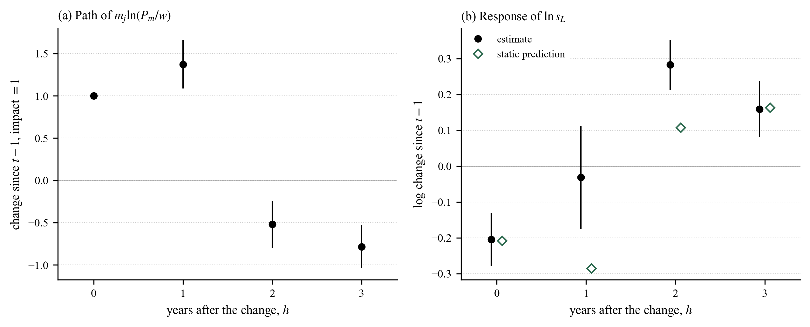

# Online Appendix to “Monetary Policy, Material Prices and the Labor Share: Evidence from Türkiye”

The full text of the Online Appendix follows, with all its tables, equations, figures and notes; the typeset version is [Online_Appendix.pdf](Online_Appendix.pdf).

**Contents**

- [OA.1 The sector panel](#oa1-the-sector-panel)
- [OA.2 The world price instrument](#oa2-the-world-price-instrument)
  - [Table OA1. Products and world prices of the instrument](#table-oa1)
- [OA.3 Robustness: all rows and one sector at a time](#oa3-robustness-all-rows-and-one-sector-at-a-time)
  - [Table OA2. Robustness of the elasticity estimates](#table-oa2)
  - [Figure OA1. Estimates without one sector at a time](#figure-oa1)
- [OA.4 Inference](#oa4-inference)
- [OA.5 Supplier prices without electricity and gas](#oa5-supplier-prices-without-electricity-and-gas)
  - [Table OA3. Cumulative supplier price responses, with and without electricity and gas](#table-oa3)
- [OA.6 The lagged coefficient of Table 5](#oa6-the-lagged-coefficient-of-table-5)
  - [Table OA4. The coefficients of Table 5, column (3), by component](#table-oa4)
- [OA.7 Local projections](#oa7-local-projections)
  - [Table OA5. Local projections of the labor share](#table-oa5)
  - [Figure OA2. Local projections of the regressor and the labor share](#figure-oa2)
- [OA.8 Heterogeneity and the share equation: further results](#oa8-heterogeneity-and-the-share-equation-further-results)
  - [Table OA6. Markup interaction](#table-oa6)
- [OA.9 Contributions to the labor share: details](#oa9-contributions-to-the-labor-share-details)
- [References](#references)

---

This Online Appendix gives the details behind the paper. Sections OA.1 and OA.2 describe the sector panel and the world price instrument. Sections OA.3 and OA.4 complete the robustness checks and the inference of Appendix B of the paper. Sections OA.5 to OA.7 add detail to the timing results of Section 4.3, Section OA.8 to the heterogeneity results of Section 4.4, and Section OA.9 to the contributions of Section 4.5. Equations, tables and figures without “OA” refer to the paper.

## OA.1 The sector panel

The panel comes from the annual industry and service statistics of TURKSTAT, the structural business statistics of Türkiye. They report personnel costs, turnover, purchases of goods and services, purchases for resale, the change in stocks, output and value added at factor cost for the two-digit sectors of NACE Rev. 2. The final revised series for 2009–2024 cover 77 sectors, and the 2025 data, which follow NACE Rev. 2.1, are not used. Agriculture, finance (K), public administration (O) and membership organizations (S94) lie outside their scope. Education, health, arts and other personal services are also left out, since the statistics do not cover their large public and non-profit producers.

Of the 68 sectors in sections B to N and S95, the main sample leaves out travel agencies (N79), advertising (M73), refined petroleum (C19), tobacco (C12) and electricity and gas (D35, Section 3.3). Travel agencies and advertising record the services that they buy for their customers as purchases. Their material intensity in the business statistics, 12.5 and 5.5, is therefore far above the input–output values of 2.2 and 2.5, and with them $`\hat{\beta}`$ is −0.162. The value added of refined petroleum is confidential in every year, and tobacco lacks the base-period intensity. The main sample therefore has 719 observations of 63 sectors over 2013–2024, and ten sectors are observed in fewer than twelve years because of confidential cells.

TURKSTAT suppresses 785 indicator-year cells at the two-digit level. Section totals are never suppressed, and the sectors add up to them exactly. A cell is therefore recovered as the section total less the other sectors when it is the only suppressed sector of its section and year, which recovers seven cells. For the change in stocks, the total of two or more suppressed sectors is allocated in proportion to their output, or to turnover or value added where output is also suppressed. This fills 145 cells, 73 of them in the main sample. No cell of personnel costs or value added is allocated. Without the cells with an allocated change in stocks, $`\hat{\beta}`$ is −0.156.

As the identities between the published indicators show, the published value added at factor cost leaves out the change in stocks of purchased goods and services, raw materials and goods for resale. The change in stocks of finished goods and work in progress enters through output. The labor share therefore uses value added corrected for the change in purchased stocks, $`VA=VA^{pub}+\Delta S`$, with intermediate consumption $`M`$ equal to output less $`VA`$. With the published figure, the labor share of retail trade (G47) exceeds one in 15 of the 16 years. With the corrected figure, the labor share exceeds one in 13 sector-years of five sectors, in loss years or in staff-intensive activities. These observations are kept.

In the 50 sectors of the sample observed in every year of 2009–2024, the annual changes of their aggregate labor share track the national accounts labor share. The correlation is 0.80 after the correction and 0.50 before it. Stocks are recorded at book value, so in years of high inflation part of $`\Delta S`$ is a holding gain. In 2021–2023 the change in stocks equals 74% to 79% of the published value added of the sample. The corrected figure is thus an upper bound on value added in these years, and the published figure, which omits the change, a lower bound. Regressed on the instrument with sector and year effects, the log ratio of corrected to published value added has a coefficient of 0.029, which is not significant.

The SBS labor share in Figure 1 of the paper uses these 50 sectors, which produced 91.7% of the 2017 value added of the main sample.

The wage is personnel costs per employee. Material intensity $`m_{j}`$ is intermediate consumption, output less value added, over value added, averaged over 2009–2012, the years of the NACE Rev. 2 series before the sample. Nine sectors have fewer than four base years because of confidential cells. With the 2012 value alone (61 sectors), or with the averages over 2010–2012 and 2009–2011, $`\hat{\beta}`$ is −0.127, −0.171 and −0.171, all significant at the 1% level.

The material price index of a sector averages the log prices of 64 supplier products, with the domestic and imported purchases of its column in the 2012 input–output table as fixed weights. Product by product, this is the first-order form of the Armington index of eq. (12). Domestic purchases of mining and manufacturing products, electricity, gas and water carry the two-digit sub-indices of the domestic producer price index (PPI) of TURKSTAT, with the section index for mining and the manufacturing index for repair and installation (C33). Agricultural products carry the agricultural PPI. Transport, accommodation and food, information, real estate services (L68B) and professional and administrative services carry the services PPI. This index starts in 2017 and is chained back with the value added deflator of the section. The value added deflators of the national accounts price the remaining products, such as construction, trade, finance, public and personal services, imputed rents (L68A) and waste (E37–E39). Imports carry the import unit value indices of TURKSTAT in TL by two-digit product of the classification of products by activity (CPA). Mining, a single product in the table, takes the section index, and printing (C18), other transport equipment (C30) and repair (C33), which have no two-digit index, take the manufacturing index. Forestry and fishing take the index of CPA 01, water that of CPA 38, and imports of electricity and services the domestic price. Products that the table merges are split with the 2012 turnover of their sectors, and monthly and quarterly indices are averaged over the year. In the average basket of the sample, producer price indices price 64% of purchases, import unit values 18% and value added deflators 16%.

The markup is output over intermediate consumption and personnel costs, $`\mu_{j}=R_{j}/(M_{j}+W_{j})`$, with $`R_{j}`$ output, $`M_{j}`$ intermediate consumption and $`W_{j}`$ personnel costs. The material share of variable cost is $`\theta_{m,j}=M_{j}/(M_{j}+W_{j})`$, and both are averaged over 2009–2012. On this cost base eq. (8) holds exactly, $`\theta_{m}/(\mu-\theta_{m})=M/VA`$, and a markup below one coincides with a labor share above one. Among the 2009–2012 averages in Table 1, only employment activities (N78) have a markup below one, 0.992. The cost of capital is left out, so the measured markup is an upper bound on the margin over full cost.[^1]

The export share is exports over output and import penetration is imports over output less exports plus imports, both for the product of the sector in the 2012 input–output table. FX loans are foreign currency cash loans over short- and long-term liabilities of the sector’s section in the 2012 sector balance sheets of the CBRT. Only bank loans are split by currency, so the ratio is a lower bound on the foreign currency debt of the section.

## OA.2 The world price instrument

The instrument of eq. (23) prices 27 goods of the 2012 input–output table (Table OA1). The table has a single mining product, which is split into coal, crude petroleum, natural gas, metal ores and other mining products. Comtrade reports Türkiye’s imports of crude petroleum and natural gas only under an unspecified code, 36.6 billion US dollars of the 2013 imports. The import values of the energy goods therefore come from the 2012 energy balance of Eurostat at world prices. The mining purchases of each column are then allocated with a RAS procedure that keeps structural zeros, so that refineries buy only crude petroleum and electricity and gas buys only natural gas and coal.

<a name="table-oa1"></a>**Table OA1. Products and world prices of the instrument**

| Product                            | Price           | HS6<br>codes | Imports<br>2013 | Weight, %<br>Mean | Weight, %<br>Largest | Log change<br>2020–2022 |
|:-----------------------------------|:----------------|-------------:|----------------:|------------------:|---------------------:|------------------------:|
| A01 Crops and livestock            | Comtrade        | 221          | 7.45            | 1.88              | 41.8 (C10–C12)       | 0.41                    |
| A02 Forestry                       | Comtrade        | 13           | 0.12            | 0.35              | 15.6 (C16)           | 0.53                    |
| A03 Fish                           | Comtrade        | 41           | 0.06            | 0.04              | 0.9 (I)              | 0.31                    |
| B05 Coal                           | Comtrade        | 3            | 0.83            | 0.27              | 6.9 (C23)            | 1.16                    |
| B06 Crude petroleum                | WB: Brent       | –            | –               | 0.00              | –                    | 0.86                    |
| B06 Natural gas                    | WB: gas, Europe | –            | –               | 0.59              | 6.1 (C20)            | 2.52                    |
| B07 Metal ores                     | Comtrade        | 18           | 1.21            | 0.72              | 7.7 (B)              | 0.40                    |
| B08 Other mining                   | Comtrade        | 55           | 0.38            | 0.44              | 9.5 (C23)            | 0.44                    |
| C10–C12 Food, beverages, tobacco   | Comtrade        | 515          | 8.25            | 1.86              | 29.8 (I)             | 0.31                    |
| C13–C15 Textiles, apparel, leather | Comtrade        | 817          | 10.31           | 2.88              | 46.0 (C13–C15)       | 0.15                    |
| C16 Wood                           | Comtrade        | 82           | 1.48            | 1.21              | 27.8 (C16)           | 0.24                    |
| C17 Paper                          | Comtrade        | 119          | 3.84            | 1.80              | 33.7 (C17)           | 0.41                    |
| C19 Refined petroleum              | Comtrade        | 18           | 20.80           | 3.38              | 32.3 (H51)           | 0.85                    |
| C20 Chemicals                      | Comtrade        | 756          | 29.12           | 4.31              | 52.6 (C20)           | 0.46                    |
| C21 Pharmaceuticals                | Comtrade        | 89           | 4.90            | 0.51              | 21.6 (C21)           | −0.07                   |
| C22 Rubber and plastics            | Comtrade        | 139          | 5.28            | 1.68              | 13.7 (C22)           | 0.14                    |
| C23 Non-metallic minerals          | Comtrade        | 158          | 2.09            | 1.55              | 18.5 (C23)           | 0.16                    |
| C24 Basic metals                   | Comtrade        | 330          | 20.30           | 4.17              | 43.5 (C25)           | 0.47                    |
| C25 Fabricated metals              | Comtrade        | 231          | 5.44            | 1.32              | 8.7 (C25)            | 0.17                    |
| C26 Electronics                    | Comtrade        | 274          | 15.53           | 1.17              | 35.8 (C26)           | 0.28                    |
| C27 Electrical equipment           | Comtrade        | 205          | 10.14           | 1.33              | 13.2 (C27)           | 0.11                    |
| C28 Machinery                      | Comtrade        | 465          | 23.77           | 0.93              | 13.1 (C28)           | 0.01                    |
| C29 Motor vehicles                 | Comtrade        | 73           | 20.27           | 0.82              | 30.0 (C29)           | 0.09                    |
| C30 Other transport equipment      | Comtrade        | 78           | 4.20            | 0.42              | 14.3 (C30)           | −0.01                   |
| C31–C32 Furniture, other goods     | Comtrade        | 200          | 4.44            | 0.49              | 10.3 (C31–C32)       | 0.10                    |
| D35 Electricity and gas            | WB: gas, coal   | –            | –               | 2.50              | 25.8 (E36)           | 2.32                    |
| E37–E39 Waste and scrap            | Comtrade        | 50           | 7.89            | 2.25              | 33.1 (E37–E39)       | 0.52                    |
| All products                       |                 | 4,840        | 208.09          | 38.85             |                      |                         |

Notes: Goods products in $`Z^{f}_{jt}`$, eq. (23). Comtrade: chained index of Türkiye’s import unit values (Section OA.2). WB: World Bank prices; electricity and gas weights gas by 0.803 and coal by 0.197. HS6 codes and imports: codes with 2013 imports and their value times the assignment share, billion US dollars; the total counts each code once. Weight: share in the variable cost of the sector’s input–output column, eq. (24), mean over the 63 sectors and largest value, with the column in parentheses; crude petroleum enters only C19, outside the sample. Log change: $`\ln P^{f}_{p,2022}-\ln P^{f}_{p,2020}`$.

Each six-digit code of the Harmonized System (HS) in Türkiye’s imports is assigned to its CPA product, a product-level concordance in the spirit of Pierce and Schott (2012). The UN correspondence between HS 2012 and the Central Product Classification (CPC 2.1), with HS 2017 for codes that it lacks, gives the CPC subclasses of each code. The correspondences from CPC 2.1 to CPA 2.1 (Eurostat) and to ISIC Rev. 4 (UN) give the producing sectors. The assignment takes the sectors common to the two, the CPA sectors when they have none in common, and the ISIC sectors when the CPA gives none. The two classifications agree for 99.5% of the codes with a single sector. Codes that map to several sectors, 0.8% of the 2013 import value, are split equally. Waste and scrap, which the ISIC correspondence does not cover, go to the CPA product of materials recovery (E37–E39).

World prices are unit values of Türkiye’s imports in UN Comtrade, import value in US dollars over net weight, from the total row of each code, which sums all partners, modes of transport and customs procedures. Where the total row has no net weight, the unit value is the sum of values over the sum of weights of the rows by mode of transport. Gaps of up to two years are filled by log-linear interpolation. The annual log change of a product’s price is the weighted mean of the log changes of its codes over the codes priced in both years. The weights are the 2013 import values times the assignment shares, and codes that enter or leave the classification do not break the series. Changes that deviate by more than $`\ln2`$ from the weighted median of the product and year are treated as measurement errors and dropped, and they carry 1.7% of the weight on average. The 24 products priced in this way rest on 4,840 codes, which account for 208.1 of the 260.8 billion US dollars of Türkiye’s imports in 2013.

Precious metals (HS 7106–7112), 15.3 billion US dollars in 2013, would map to basic metals. Most of these imports are gold, which the input–output table records as re-exported, so they are left out. Printing (C18) maps to a single code that does not represent the product, and water (E36) and services have no traded price, so these products receive no world price. The weights of a sector therefore sum to the share of priced goods in its variable cost, 0.389 on average.

Crude petroleum takes the Brent price and natural gas the European gas price of the World Bank commodity price data, as annual averages. Electricity and gas supply (D35) takes a composite. The price of electricity combines gas and coal with their shares in the 2012 fuel costs of electricity generation, 0.780 for gas, from the input quantities of the Eurostat energy balance at 2012 world prices. Gas distribution, 0.105 of the 2012 output of electricity and gas in the structural business statistics, takes the gas price. Comtrade reports the imports of electricity without net weight, so they are not used.

The product indices follow world prices. Over 2014–2024 their annual log changes have correlations of 0.93 (basic metals) and 0.96 (waste and scrap) with the World Bank index of metals and minerals, and of 0.98 (refined petroleum) and 0.90 (chemicals) with Brent. The correlations are 0.94 for metal ores with the World Bank composite of ores and 0.94 for coal with the World Bank coal price. They are 0.93 (crops and livestock) and 0.87 (food) with the World Bank composite of agricultural prices. The exception is forestry products (A02), whose codes changed in 2017. Their correlation with World Bank timber prices is −0.24, and their weight is small.

## OA.3 Robustness: all rows and one sector at a time

Table OA2 is Table B1 of the paper with all thirteen rows and its full notes. Rows (8), a control for material intensity times the real interest rate, and (13), the long difference over 2017–2022, appear only here, so rows (9) to (12) are rows (8) to (11) of Table B1.

Table OA2 varies the measurement, the identification, the deflator of the exchange rate and the form of the equation. It reports the single material price elasticity, $`\beta`$ of eq. (19), and the coefficients of the two channels, $`\beta^{f}`$ and $`\beta^{e}`$ of eq. (20). Every estimate is negative irrespective of these variations.

<a name="table-oa2"></a>**Table OA2. Robustness of the elasticity estimates**

|                                                                         | Eq.&nbsp;(19)<br>$`\beta`$ | Eq.&nbsp;(19)<br>$`F`$ | Eq.&nbsp;(20)<br>$`\beta^{f}`$ | Eq.&nbsp;(20)<br>$`\beta^{e}`$ | $`N/G`$ |
|:------------------------------------------------------------------------|:--------------------------:|:----------------------:|:------------------------------:|:------------------------------:|:-------:|
| **Panel A: Cost index and value added**                                 |                            |                        |                                |                                |         |
| (1) Baseline                                                            | −0.159<sup>\*\*\*</sup>    | 352                    | −0.184<sup>\*\*\*</sup>        | −0.212<sup>\*\*\*</sup>        | 719/63  |
|                                                                         | (0.027) [0.006]            |                        | (0.031) [0.005]                | (0.056) [0.015]                |         |
| (2) Composite cost, $`C_{jt}=w^{\alpha_{j}}_{jt}r^{1-\alpha_{j}}_{jt}`$ | −0.143<sup>\*\*\*</sup>    | 218                    | –                              | –                              | 719/63  |
|                                                                         | (0.023) [0.003]            |                        |                                |                                |         |
| (3) Section value added deflator                                        | −0.295<sup>\*\*\*</sup>    | 40                     | –                              | –                              | 719/63  |
|                                                                         | (0.075) [0.072]            |                        |                                |                                |         |
| (4) Published value added                                               | −0.120<sup>\*\*\*</sup>    | 358                    | −0.136<sup>\*\*\*</sup>        | −0.139<sup>\*</sup>            | 716/63  |
|                                                                         | (0.035) [0.061]            |                        | (0.040) [0.063]                | (0.077) [0.199]                |         |
| **Panel B: Identification**                                             |                            |                        |                                |                                |         |
| (5) $`Z^{f}`$ without own product                                       | −0.155<sup>\*\*\*</sup>    | 243                    | −0.183<sup>\*\*\*</sup>        | −0.211<sup>\*\*\*</sup>        | 719/63  |
|                                                                         | (0.030) [0.006]            |                        | (0.034) [0.005]                | (0.057) [0.012]                |         |
| (6) Section-by-year effects                                             | −0.151<sup>\*\*\*</sup>    | 219                    | −0.166<sup>\*\*\*</sup>        | −0.128<sup>\*\*</sup>          | 719/63  |
|                                                                         | (0.024) [0.047]            |                        | (0.023) [0.019]                | (0.063) [0.232]                |         |
| (7) Sum of instrument weights × year                                    | −0.158<sup>\*\*</sup>      | 44                     | −0.138<sup>\*\*</sup>          | −0.098                         | 719/63  |
|                                                                         | (0.073) [0.067]            |                        | (0.059) [0.054]                | (0.118) [0.431]                |         |
| (8) $`m_{j}\times`$ real interest rate                                  | −0.168<sup>\*\*\*</sup>    | 84                     | −0.161<sup>\*\*\*</sup>        | −0.188<sup>\*\*\*</sup>        | 719/63  |
|                                                                         | (0.048) [0.026]            |                        | (0.031) [0.006]                | (0.059) [0.044]                |         |
| (9) Sample including electricity and gas (D35)                          | −0.093<sup>\*\*\*</sup>    | 53                     | −0.111<sup>\*\*\*</sup>        | −0.179<sup>\*\*\*</sup>        | 731/64  |
|                                                                         | (0.030) [0.059]            |                        | (0.035) [0.063]                | (0.056) [0.021]                |         |
| **Panel C: Deflator of the exchange rate**                              |                            |                        |                                |                                |         |
| (10) Average wage, $`E_{t}/\bar{w}_{t}`$                                | –                          | –                      | −0.140<sup>\*\*\*</sup>        | −0.151<sup>\*\*\*</sup>        | 719/63  |
|                                                                         |                            |                        | (0.022) [0.002]                | (0.039) [0.007]                |         |
| (11) Consumer price index, $`E_{t}/CPI_{t}`$                            | –                          | –                      | −0.107<sup>\*\*\*</sup>        | −0.105<sup>\*\*\*</sup>        | 719/63  |
|                                                                         |                            |                        | (0.023) [0.004]                | (0.034) [0.022]                |         |
| **Panel D: Differences**                                                |                            |                        |                                |                                |         |
| (12) First differences                                                  | −0.196<sup>\*\*\*</sup>    | 163                    | −0.281<sup>\*\*\*</sup>        | −0.306<sup>\*\*\*</sup>        | 643/63  |
|                                                                         | (0.031) [0.005]            |                        | (0.040) [0.003]                | (0.055) [0.001]                |         |
| (13) Long difference, 2017–2022                                         | −0.121<sup>\*\*\*</sup>    | 80                     | −0.128                         | −0.343                         | 56/56   |
|                                                                         | (0.035) [0.005]            |                        | (0.087) [0.122]                | (0.274) [0.241]                |         |

Notes: Row (1) is the baseline of Tables 2 and 3. Rows (2) and (3) change $`C_{jt}`$, which eq. (20) does not contain: in (2), $`\alpha_{j}`$ is the 2009–2012 labor share and $`r_{jt}`$ the user cost of capital, floored at the depreciation rate; in (3), the value added deflator of the section replaces $`C_{jt}`$. (7) $`m_{j}\sum_{p}\omega_{jp}`$, with the weights of eq. (24), times year indicators. (8) Real interest rate: commercial loan rate less expected inflation. (10) $`\bar{w}_{t}`$: average wage of the covered sectors. $`F`$: cluster-robust first-stage $`F`$ of $`\beta`$; for $`\beta^{f}`$ it is at least 42. An instrument built from World Bank prices of ten commodity groups, instead of import unit values, gives $`\beta=-0.171`$ (0.036), with a first-stage $`F`$ of 73. With $`\ln P_{m}`$ and $`\ln w`$ as separate regressors, each times $`m_{j}`$, the coefficients are −0.132 and 0.122, and their sum, −0.009 (0.006), is not significant; with the wage also instrumented, by the current and the lagged instrument, they are −0.321 and 0.366, and their sum, 0.045 (0.022), is significant at the 5% level, so homogeneity holds only approximately. With the CPI or the average wage as the deflator, the share of the two channels in the 2017–2022 fall is larger, 30% and 40%, against 22% with $`P_{t}`$ (Table 7). Standard errors clustered by sector in parentheses; stars and brackets as in Table 2.

Panel A changes the cost index $`C_{jt}`$ of eq. (19) and the measure of value added. With the composite primary input cost, which includes the user cost of capital ($`r`$) along with the wage ($`w`$), $`\hat{\beta}`$ is −0.143. With the value added deflator of the section ($`D`$) in place of the wage, it is −0.295, nearly twice as large. The ratio of our headline estimate to this one, 0.54, is well below one. It is close to the average $`k`$ of about 0.6, as eq. (22) predicts. With value added as published, without the change in purchased stocks, the estimates are smaller in absolute value.

Panel B probes the identification. Excluding the world price of each sector’s own product from the instrument leaves the estimates almost unchanged. Section-by-year effects, which leave only the variation within sections, change $`\hat{\beta}`$ and $`\hat{\beta}^{f}`$ little but shrink $`\hat{\beta}^{e}`$. With the sum of the instrument weights interacted with year effects (Borusyak et al., 2022), $`\hat{\beta}`$ keeps its size but loses precision. This control absorbs most of the variation of the real exchange rate term, and $`\hat{\beta}^{e}`$ is no longer significant. Low and negative real interest rates went with a weaker TL in 2017–2022 (Gürkaynak et al., 2023). They may also act through the cost of capital. A control for material intensity times the real interest rate leaves the estimates close to the baseline. Its own coefficient is not significant. With electricity and gas (D35) in the sample, $`\hat{\beta}`$ is −0.093 (Section 3.3).

Panel C shows the two channels with the exchange rate deflated by the average wage ($`\bar{w}`$) and by the consumer price index (CPI). Both coefficients are smaller in absolute value but remain significant at the 1% level, and their equality is not rejected.

Panel D reports the estimates in differences. In first differences $`\hat{\beta}`$ is −0.196. In the long difference between 2017 and 2022, $`\hat{\beta}`$ is −0.121, and the two channel coefficients keep their sign but lose precision.

Dropping one sector at a time keeps $`\hat{\beta}`$ between −0.196 and −0.150 (Figure OA1). All three estimates, $`\hat{\beta}`$, $`\hat{\beta}^{f}`$ and $`\hat{\beta}^{e}`$, stay negative and significant at the 1% level in every case. Without the 22 manufacturing sectors the estimate is similar but imprecise, and without mining it is almost unchanged, −0.169.

<a name="figure-oa1"></a>

**Figure OA1. Estimates without one sector at a time**

Notes: Each row drops the sector named on the left: (a) $`\beta`$ of eq. (19); (b) $`\beta^{f}`$ and (c) $`\beta^{e}`$ of eq. (20). Markers are the estimates and lines their 95% intervals (clustered by sector); vertical line in the panel’s color: the estimate on all 63 sectors; gray line: zero.

Two further checks concern the instrument and the two-channel equation. With one of the 27 products dropped from the instrument at a time, our headline estimate of Table 2 ranges from −0.171 to −0.151, with a first-stage $`F`$ of at least 36. After the sector and year effects, the dollar price term and the real exchange rate term of eq. (20) have a correlation of −0.56.

## OA.4 Inference

The tables of the paper and of this appendix give wild cluster bootstrap $`p`$ values in brackets. For 2SLS the bootstrap is the restricted efficient wild bootstrap of Davidson and MacKinnon (2010), and for OLS the restricted wild bootstrap. Both use Webb weights and 9,999 replications (Cameron et al., 2008; Webb, 2023; Roodman et al., 2019).

Clustered standard errors can over-reject in shift-share designs (Adão et al., 2019). Table B2 of the paper reports tests that do not rely on them. The placebo tests rebuild the instrument from resampled or reshuffled world price changes, and the permutation tests reassign the exposures of the sectors. The placebo distributions of the $`t`$ statistic are wider than the clustered standard errors imply. Still, every test rejects a zero effect of the material price on the labor share at the 10% level, and most reject it at the 1% level. The table also reports the reduced form, the regression of the labor share on the instrument itself.

The clustered standard errors are CR0 for 2SLS and CR1 for OLS. Wild cluster bootstrap $`p`$ values are more conservative than the clustered test but can also over-reject in shift-share designs (Adão et al., 2019). At the 5% level, the clustered test rejects in 48% of the placebo draws for 2SLS and in 59% for the reduced form, and the bootstrap in 22% for the reduced form.

## OA.5 Supplier prices without electricity and gas

Table OA3 reports the cumulative responses of supplier prices to a depreciation by route, month by month, from eq. (25) with twelve monthly lags. With all 21 products (Panel A), the network response ($`\phi_{n}`$) builds up over the year, while the direct response ($`\phi_{d}`$) fades within the year. Without electricity and gas (Panel B), whose prices are administered, the network response does not build up after the first month and is imprecise, while the direct response fades as before. The build-up of the network response up to month 12 in Table 4 thus comes mostly from electricity and gas. With one product dropped at a time, the impact coefficient of Table 4 ranges from 1.13 to 1.28.

In Table 4 of the paper, the component correlation is the correlation of the direct and the network exposure terms across products. In its Panel B, the consumer price control enters the monthly columns only, the import price control enters with lags, and the agricultural and service products are priced by the agricultural and services PPI.

<a name="table-oa3"></a>**Table OA3. Cumulative supplier price responses, with and without electricity and gas**

|                                                             | Month 0                | Month 1                | Month 2                | Month 3                | Month 12            |
|:------------------------------------------------------------|:----------------------:|:----------------------:|:----------------------:|:----------------------:|:-------------------:|
| **Panel A: 21 supplier products**                           |                        |                        |                        |                        |                     |
| Direct, $`\phi_{d}`$                                        | 1.118<sup>\*\*\*</sup> | 1.207<sup>\*\*\*</sup> | 1.261<sup>\*\*\*</sup> | 1.294<sup>\*\*\*</sup> | 0.179               |
|                                                             | (0.127)                | (0.189)                | (0.266)                | (0.377)                | (0.452)             |
| Network, $`\phi_{n}`$                                       | 1.358<sup>\*\*\*</sup> | 1.755<sup>\*\*\*</sup> | 2.600<sup>\*\*\*</sup> | 2.313<sup>\*</sup>     | 3.754<sup>\*</sup>  |
|                                                             | (0.336)                | (0.538)                | (0.941)                | (1.329)                | (2.212)             |
| **Panel B: Without electricity and gas (D35), 20 products** |                        |                        |                        |                        |                     |
| Direct, $`\phi_{d}`$                                        | 1.134<sup>\*\*\*</sup> | 1.198<sup>\*\*\*</sup> | 1.068<sup>\*\*\*</sup> | 1.007<sup>\*\*\*</sup> | −0.344<sup>\*</sup> |
|                                                             | (0.165)                | (0.235)                | (0.221)                | (0.241)                | (0.193)             |
| Network, $`\phi_{n}`$                                       | 1.518<sup>\*</sup>     | 1.666                  | 0.759                  | −0.410                 | −1.216<sup>\*</sup> |
|                                                             | (0.846)                | (1.135)                | (0.926)                | (1.079)                | (0.681)             |

Notes: Cumulative coefficients of eq. (25) with the direct and the network exposure and twelve monthly lags, product and month effects, 2013M1–2024M12; 3,024 product-months in Panel A and 2,880 in Panel B. Months 2 and 12 of Panel A are columns (4) and (6) of Table 4; month 0 differs from its impact column, which has no lags. Standard errors clustered by product in parentheses; stars as in Table 2.

## OA.6 The lagged coefficient of Table 5

Table OA4 splits the coefficients of column (3) of Table 5 by component, on the 643 sector-years with positive published value added, where the parts add up exactly. The log labor share is the log labor share with published value added plus a stock term, the log of published over corrected value added. The former is log personnel costs less log published value added, and personnel costs split into the wage and employment. The partial recovery in the following year comes mostly from the stock term and from personnel costs catching up, two thirds of them through wages; with value added as published, the lagged coefficient is small and not significant.

<a name="table-oa4"></a>**Table OA4. The coefficients of Table 5, column (3), by component**

|                                                                 | Year of the change, $`\beta_{0}`$ | Following year, $`\beta_{1}`$ | Two-year sum            |
|:----------------------------------------------------------------|:---------------------------------:|:-----------------------------:|:-----------------------:|
| (1) Labor share, $`\ln s_{L}`$                                  | −0.257<sup>\*\*\*</sup>           | 0.111<sup>\*\*</sup>          | −0.146<sup>\*\*\*</sup> |
|                                                                 | (0.031)                           | (0.045)                       | (0.039)                 |
| (2) Stock term, $`\ln(VA^{pub}/VA)`$                            | −0.095<sup>\*\*</sup>             | 0.062<sup>\*\*\*</sup>        | −0.033                  |
|                                                                 | (0.038)                           | (0.016)                       | (0.038)                 |
| (3) Labor share with published value added, $`\ln s^{pub}_{L}`$ | −0.162<sup>\*\*\*</sup>           | 0.049                         | −0.113<sup>\*\*\*</sup> |
|                                                                 | (0.051)                           | (0.051)                       | (0.039)                 |
| (4) &emsp;Personnel costs, $`\ln W`$                            | 0.009                             | 0.042<sup>\*\*</sup>          | 0.051                   |
|                                                                 | (0.028)                           | (0.018)                       | (0.039)                 |
| (5) &emsp;&emsp;Wage, $`\ln w`$                                 | 0.011                             | 0.028<sup>\*</sup>            | 0.039<sup>\*</sup>      |
|                                                                 | (0.011)                           | (0.015)                       | (0.021)                 |
| (6) &emsp;&emsp;Employment, $`\ln L`$                           | −0.002                            | 0.014                         | 0.012                   |
|                                                                 | (0.024)                           | (0.012)                       | (0.033)                 |
| (7) &emsp;Published value added, $`-\ln VA^{pub}`$              | −0.171<sup>\*\*\*</sup>           | 0.007                         | −0.164<sup>\*\*\*</sup> |
|                                                                 | (0.060)                           | (0.061)                       | (0.060)                 |

Notes: 2SLS estimates of eq. (26) with each component as the dependent variable, on the 643 sector-years of 2014–2024 with positive published value added (63 sectors); the current and the lagged regressor are instrumented by $`m_{j}Z^{f}`$ of the same year (Sanderson–Windmeijer $`F`$ 135 and 293). Rows (1) = (2) + (3), (3) = (4) + (7) and (4) = (5) + (6) hold exactly. On all 651 sector-years the lagged coefficient is 0.113 (Table 5). Sector and year effects; standard errors clustered by sector in parentheses; stars as in Table 2.

## OA.7 Local projections

Eq. (26) limits the response of the labor share to the year of a change in the price of materials and the following year. Local projections (Jordà, 2005) estimate the response at each horizon separately. For $`h=0,\ldots,3`$,

```math
\ln s_{L,j,t+h}-\ln s_{L,j,t-1}=\beta_{h}\,m_{j}\ln\left(\frac{P_{m,jt}}{C_{jt}}\right)+\gamma_{h}\,m_{j}\ln\left(\frac{P_{m,j,t-1}}{C_{j,t-1}}\right)+\delta^{h}_{j}+\delta^{h}_{t}+\varepsilon_{j,t+h}, \qquad \text{(OA.1)}
```

where the left-hand side is the change in the log labor share from the year before the change, $`t-1`$, to $`h`$ years after it. The terms $`\delta^{h}_{j}`$ and $`\delta^{h}_{t}`$ are sector and year effects for each horizon. As in the baseline, $`C_{jt}`$ is the wage $`w_{jt}`$. The second regressor holds the price of the previous year fixed, so $`\beta_{h}`$ is the response to a rise in year $`t`$. Both regressors are instrumented by $`m_{j}Z^{f}`$ of the same year, as in eq. (26).

Table OA5 and Figure OA2 report the estimates. All horizons use the same 447 observations of 59 sectors, with start years 2014–2021. Panel (a) of Figure OA2 shows the path of the regressor after a rise in year $`t`$. Panel (b) shows the response of the labor share next to the static prediction. In the year of the rise, the labor share falls about as much as the static estimate on the same observations implies. Two years later materials are cheaper relative to the wage than before the rise, and the labor share is above its initial level. Averaged over the next three years, the response per unit of the price change does not differ significantly from the response on impact. The static elasticity of eq. (19) thus holds on average over time.

The response one year after the rise is imprecise and depends on the lag structure. In sectors with a larger rise, the labor share was already falling in the year before. With this lagged change as a control, the pattern is the same (Table OA5, last row).

<a name="table-oa5"></a>**Table OA5. Local projections of the labor share**

|                                           | $`\ln s_{L,jt}`$<br>(1) Static | $`\ln s_{L,j,t+h}`$<br>$`-\ln s_{L,j,t-1}`$<br>(2) $`h=0`$ | $`\ln s_{L,j,t+h}`$<br>$`-\ln s_{L,j,t-1}`$<br>(3) $`h=1`$ | $`\ln s_{L,j,t+h}`$<br>$`-\ln s_{L,j,t-1}`$<br>(4) $`h=2`$ | $`\ln s_{L,j,t+h}`$<br>$`-\ln s_{L,j,t-1}`$<br>(5) $`h=3`$ |
|:------------------------------------------|:------------------------------:|:----------------------------------------------------------:|:----------------------------------------------------------:|:----------------------------------------------------------:|:----------------------------------------------------------:|
| $`m_{j}\ln(P_{m,jt}/w_{jt})`$             | −0.208<sup>\*\*\*</sup>        | −0.205<sup>\*\*\*</sup>                                    | −0.031                                                     | 0.283<sup>\*\*\*</sup>                                     | 0.159<sup>\*\*\*</sup>                                     |
|                                           | (0.035) [0.024]                | (0.038) [0.030]                                            | (0.073) [0.715]                                            | (0.035) [0.006]                                            | (0.040) [0.115]                                            |
| Static prediction                         |                                | −0.208                                                     | −0.285                                                     | 0.108                                                      | 0.163                                                      |
| Path of $`m_{j}\ln(P_{m}/w)`$             |                                | 1                                                          | 1.373<sup>\*\*\*</sup>                                     | −0.520<sup>\*\*\*</sup>                                    | −0.786<sup>\*\*\*</sup>                                    |
|                                           |                                |                                                            | (0.147)                                                    | (0.142)                                                    | (0.130)                                                    |
| Controlling for $`\Delta\ln s_{L,j,t-1}`$ |                                | −0.258<sup>\*\*\*</sup>                                    | −0.125<sup>\*</sup>                                        | 0.175<sup>\*\*\*</sup>                                     | 0.055                                                      |
|                                           |                                | (0.047) [0.024]                                            | (0.064) [0.069]                                            | (0.027) [0.014]                                            | (0.039) [0.327]                                            |

Notes: Column (1): eq. (19) on the observations of columns (2)–(5). Columns (2)–(5): local projections, eq. (OA.1), with start years 2014–2021 and the same 447 observations of 59 sectors at every horizon (442 with $`\Delta\ln s_{L,j,t-1}`$ as a control). The current and the lagged regressor are instrumented by $`m_{j}Z^{f}`$ of the same year; first-stage $`F`$ of Sanderson and Windmeijer (2016) 355 and 129 (398 and 138 with the control), 494 in column (1). Static prediction: column (1) times the path; the path is the response of $`m_{j}\ln(P_{m,jt}/w_{jt})`$ itself. Per unit of the path, the response averages −0.256 over $`h=1`$ to 3, against −0.205 at $`h=0`$; the difference, −0.051 (0.055), is not significant. With $`\ln s_{L,j,t-2}-\ln s_{L,j,t-1}`$ on the left, the coefficient is 0.175 (0.038). Sector and year effects at each horizon; standard errors clustered by sector in parentheses; stars and brackets as in Table 2.

<a name="figure-oa2"></a>

**Figure OA2. Local projections of the regressor and the labor share**

Notes: Estimates of Table OA5, columns (2)–(5). (a) Path of $`m_{j}\ln(P_{m,jt}/w_{jt})`$ after a rise in year $`t`$, 1 at $`h=0`$. (b) Response of $`\ln s_{L}`$ and static prediction, column (1) of Table OA5 times the path. Lines: 95% intervals, clustered by sector.

## OA.8 Heterogeneity and the share equation: further results

Table OA6 interacts the regressor of eq. (19) and its instrument with the 2009–2012 markup of the sector, centered at its mean of 1.196. The interaction is negative, as (P2) predicts, but imprecise. Panel B of Table 6 in the paper makes the comparison across terciles of the markup instead. With materials measured as all purchases or as intermediate consumption, the 2SLS estimate of $`\sigma`$ is 0.079 and 0.232, against 0.139 in Panel C of Table 6. Panel C of Table 6 uses the 585 sector-years of 60 sectors with purchases and purchases for resale observed, and the standard error of $`\beta^{implied}`$ comes from the delta method, treating $`\hat{\sigma}`$ and $`\hat{\beta}`$ as independent.

<a name="table-oa6"></a>**Table OA6. Markup interaction**

|                                            | 2SLS                  |
|:-------------------------------------------|:---------------------:|
| $`m_{j}\ln(P_{m}/w)`$                      | −0.206<sup>\*\*</sup> |
|                                            | (0.102) [0.125]       |
| $`(\mu_{j}-\bar{\mu})\,m_{j}\ln(P_{m}/w)`$ | −0.423                |
|                                            | (0.906) [0.778]       |
| Smallest SW $`F`$                          | 161                   |
| $`N/G`$                                    | 713/62                |

Notes: 2SLS estimate of eq. (19) with the regressor and the instrument interacted with the markup of 2009–2012, centered at its mean of 1.196. SW $`F`$: Sanderson–Windmeijer. Sector and year effects; standard errors clustered by sector in parentheses; stars and brackets as in Table 2.

## OA.9 Contributions to the labor share: details

Table 7 of the paper covers the 53 sectors observed in every year of 2013–2024, which produced 92.6% of the 2017 value added of the sample. In 2017–2022 their labor share fell from 44.86% to 30.54%, most of it within sectors; with value added as published, the fall is about 11 pp. Attributed to the shocks themselves, higher world prices lowered the labor share by 2.20 pp and the real depreciation by 1.54 pp. This split uses the reduced form, with $`m_{j}Z^{f}_{jt}`$ in place of the dollar price term, and need not add up to the two-channel total, since the dollar price of materials also moves with domestic shocks. In 2017–2022 the 95% interval of the two-channel total is [−4.75, −1.58], and the year effects of eq. (19) fall by 0.179 log points. For the national accounts labor share, sector contributions are averaged within sections with previous-year personnel costs as weights and converted with section value added and labor shares; they are zero for sections A, D, P, Q and R.

Sector contributions from eq. (28) are converted into pp with the previous-year labor share, weighted by previous-year value added and summed over the years of a period.

## References

Adão, R., Kolesár, M. and Morales, E. (2019). Shift-share designs: Theory and inference. *The Quarterly Journal of Economics*, 134(4), 1949–2010. https://doi.org/10.1093/qje/qjz025

Borusyak, K., Hull, P. and Jaravel, X. (2022). Quasi-experimental shift-share research designs. *The Review of Economic Studies*, 89(1), 181–213. https://doi.org/10.1093/restud/rdab030

Cameron, A. C., Gelbach, J. B. and Miller, D. L. (2008). Bootstrap-based improvements for inference with clustered errors. *The Review of Economics and Statistics*, 90(3), 414–427. https://doi.org/10.1162/rest.90.3.414

Davidson, R. and MacKinnon, J. G. (2010). Wild bootstrap tests for IV regression. *Journal of Business & Economic Statistics*, 28(1), 128–144. https://doi.org/10.1198/jbes.2009.07221

Gürkaynak, R. S., Kısacıkoğlu, B. and Lee, S. S. (2023). Exchange rate and inflation under weak monetary policy: Turkey verifies theory. *Economic Policy*, 38(115), 519–560. https://doi.org/10.1093/epolic/eiad020

Jordà, Ò. (2005). Estimation and inference of impulse responses by local projections. *American Economic Review*, 95(1), 161–182. https://doi.org/10.1257/0002828053828518

Pierce, J. R. and Schott, P. K. (2012). A concordance between ten-digit U.S. Harmonized System codes and SIC/NAICS product classes and industries. *Journal of Economic and Social Measurement*, 37(1–2), 61–96. https://doi.org/10.3233/JEM-2012-0351

Roodman, D., Nielsen, M. Ø., MacKinnon, J. G. and Webb, M. D. (2019). Fast and wild: Bootstrap inference in Stata using boottest. *The Stata Journal*, 19(1), 4–60. https://doi.org/10.1177/1536867X19830877

Sanderson, E. and Windmeijer, F. (2016). A weak instrument F-test in linear IV models with multiple endogenous variables. *Journal of Econometrics*, 190(2), 212–221. https://doi.org/10.1016/j.jeconom.2015.06.004

Webb, M. D. (2023). Reworking wild bootstrap-based inference for clustered errors. *Canadian Journal of Economics*, 56(3), 839–858. https://doi.org/10.1111/caje.12661

[^1]: A markup built from turnover over purchases and personnel costs averages 1.078 in the sample and falls below one in 22% of the observations. Goods bought for resale enter both its turnover and its purchases and pull it toward one. Its purchases also include stock building, so it does not satisfy eq. (8) and is not used.
